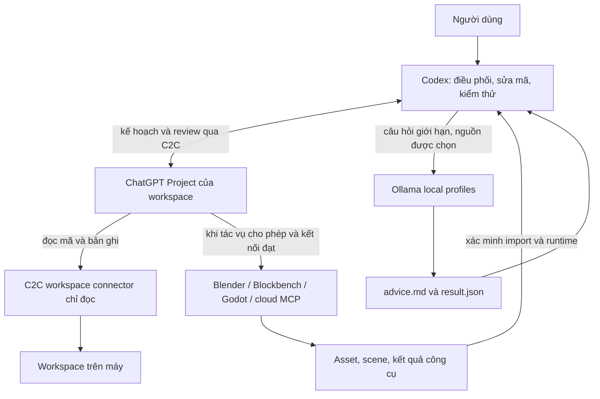

# Hướng dẫn triển khai Codex + ChatGPT + AI Local + MCP

Tài liệu vận hành cho người dùng và AI Agent. Mốc kiểm tra: 08/11/2026, múi giờ Asia/Saigon.
Các đường dẫn F: bên dưới là cấu hình máy hiện tại; phải thay bằng đường dẫn được phát hiện trên máy đích. Không coi version, tên tool hay giao diện web là bất biến.

## 1. Kiến trúc và quyền sở hữu



Codex chịu trách nhiệm cuối cùng. ChatGPT đọc dự án qua connector để lập kế hoạch/review; nó không được cấp quyền ghi workspace qua C2C. MCP ứng dụng có thể có quyền thay đổi asset/scene riêng: quyền này độc lập với C2C. AI local là người viết mã theo task nhỏ qua Invoke-LocalCoder; mã nằm trong staging. Codex review/apply/test và gửi report để local sửa. Helper không tự chạy code hoặc gọi MCP. Xem TEAM-CONTRACT.vi.md cho quy tắc local-first hiện hành.

Không để hai bên đồng thời sửa cùng file. Nếu ChatGPT sử dụng MCP tạo asset, giao rõ ứng dụng, file đầu ra, hệ tọa độ, kích thước, định dạng và tiêu chí nghiệm thu. Codex kiểm tra file được xuất thật rồi kiểm tra import/runtime. Không dùng ảnh chụp màn hình thay cho file asset gốc.

## 2. Kiểm kê trước khi cài

1. Đọc AGENTS.md ở thư mục cha và workspace; giữ nguyên thay đổi của người dùng.
2. Xác định workspace tuyệt đối, stack, có Git hay chưa, phần nào thực sự cần MCP.
3. Kiểm tra Node, PowerShell, Codex, Ollama và GPU/RAM:

```powershell
node --version
pwsh --version
codex --version
codex --help
ollama --version
ollama list
ollama ps
nvidia-smi --query-gpu=name,memory.total,memory.used --format=csv,noheader
```

Máy hiện tại: Ryzen 7 7800X3D, khoảng 31,2 GiB RAM hữu dụng, RTX 5060 Ti 8 GB. Ollama ở `F:\AI\Ollama\App\ollama.exe`; `OLLAMA_MODELS` ở `F:\AI\Ollama\Models`. Không di chuyển kho model khi chỉ triển khai dự án khác.

4. Kiểm tra model đang nạp và ứng dụng GPU khác. Không chạy ComfyUI Flux2 cùng coding model trên cấu hình này. Các threshold trong helper chỉ là chặn sớm, không bảo đảm không OOM.
5. Phân biệt bốn trạng thái: **có tệp cài**, **đã đăng ký**, **gọi tool live thành công**, **đã chạy trọn tác vụ thực tế**. Ghi riêng từng trạng thái.

## 3. Ollama và model theo tác vụ

Máy hiện tại đã có các trọng số cần thiết. Trên máy mới, cài Ollama từ nguồn chính thức, khởi động server, kiểm tra API version rồi mới tải:

```powershell
ollama pull mimo-v2.6:9b-q4_K_M
ollama pull north-mini-code-1.0:latest
ollama pull qwen3.8:27b
```

Chọn tag rõ ràng thay vì tự thay sang model mới. MiMo hiện yêu cầu Ollama >= 0.40.15 theo manifest đã kiểm tra. Trước khi áp dụng về sau phải kiểm tra lại `ollama show` và tài liệu model. Chỉ xóa model cũ khi có yêu cầu; không xóa blob bằng tay.

| Vai trò | Alias | Thinking trong helper | Bộ nhớ trên máy hiện tại |
|---|---|---|---|
| Web/UI/component | local-web | Tắt | MiMo 9B Q4_K_M, GPU tự phân bổ |
| Web game giáo dục | local-game | Tắt | MiMo 9B Q4_K_M, GPU tự phân bổ |
| Mã tổng quát | local-code | Tắt | Qwen3-Coder 30B, GPU tự phân bổ; guard RAM 22 GiB |
| AI brain/agent/tool | local-brain | Bật | North, CPU vì CUDA đã lỗi hai lần |
| Curriculum/progress/mastery | local-learning | Bật | North, CPU |
| Kiến trúc/review khó | local-review | Bật | Qwen3.8 27B, GPU/CPU tự phân bổ |

`Setup-Profiles.ps1` dùng API `/api/create`, tạo alias chia sẻ trọng số và giữ sampling của model gốc. Tất cả đặt context 8192, output mặc định 4096. Tên alias hiện là cấp máy, nên các dự án trên cùng máy sẽ dùng chung alias; không tùy ý đổi vai trò của alias cho một dự án mà không xét dự án khác.

```powershell
cd F:\Projects\AI-LOCAL
.\Setup-Profiles.ps1
.\Test-LocalWorkflow.ps1
```

`Test-LocalWorkflow.ps1` dùng mock HTTP và thư mục test riêng, không tải/nạp model. Để kiểm tra inference thật: `.\Test-Profiles.ps1 -Tasks web` trước; chỉ mở rộng khi còn đủ tài nguyên. Script inference này dùng Ask-Local và resource guard; vẫn chỉ chạy khi ứng dụng GPU khác không đang làm việc. Smoke test tắt thinking, không chứng minh chất lượng code/agent/vision.

## 4. Luồng tham vấn tùy chọn (luồng viết mã xem TEAM-CONTRACT.vi.md)

```powershell
.\Invoke-LocalAdvice.ps1 -Task web `
  -Prompt 'Kiểm tra việc xử lý lỗi trong file này; chỉ nêu lỗi có bằng chứng' `
  -ContextFile .\Ask-Local.ps1 -MaxTokens 1024 -TimeoutSec 300
```

1. Codex đọc mã và chọn câu hỏi nhỏ, chính xác.
2. Helper chỉ đọc các `ContextFile` được chỉ định. Không quét toàn dự án.
3. Helper kiểm tra ComfyUI queue; nếu có việc chạy/chờ thì từ chối nạp coding model. Cổng ComfyUI mở nhưng API lỗi, sai cấu trúc hoặc không xác minh được socket cũng bị chặn; kết nối bị từ chối xác nhận server không nghe cổng đó. Trên Windows kiểm tra RAM trống: web/game >= 6 GiB; brain/learning/code >= 22 GiB; review >= 21 GiB. Đây là ước lượng bảo thủ cho cấu hình hiện tại.
4. FileStream với `FileShare.None` giữ khóa tới khi `Dispose`, tuần tự hóa các helper trong cùng thư mục. Không khóa được mọi Ollama client hoặc mọi dự án khác. Nếu timeout HTTP, công việc server có thể chưa dừng ngay; kiểm tra `ollama ps` trước khi thử lại.
5. Nếu Ollama đã có model đang nạp thì từ chối; không unload công việc của client khác. Đặt `keep_alive=0` cho lượt gọi của helper. Chỉ unload thủ công model khác sau khi kiểm tra nó không phục vụ client khác. Không chạy helper đồng thời với client Ollama khác.
6. Giới hạn 12000 ký tự cho prompt + context. Đây không phải tokenizer; vẫn phải chọn excerpt nhỏ và chừa ngân sách system/output trong 8K.
7. Helper trả đường dẫn `local-runs/<id>/advice.md`; `result.json` ghi model, task, độ dài prompt, tên file nguồn, trạng thái, thời gian, số token và câu trả lời. Không lưu thinking hoặc prompt mặc định. `-SavePrompt` là lựa chọn lưu prompt rõ ràng; câu trả lời vẫn có thể lặp lại source nên không gửi secrets.
8. `completed`: có câu trả lời hoàn chỉnh. `truncated`: hết output budget; không coi là review đạt. `failed`: lỗi được ghi. Nếu thinking dùng hết ngân sách, giảm phạm vi, tăng output hợp lý hoặc dùng `-DisableThinking` cho câu hỏi ngắn.
9. Codex đối chiếu đề xuất với mã, triển khai phần đúng rồi chạy kiểm thử thật. Không thực thi lệnh do local sinh ra một cách tự động.

Lượt thử thực tế đã phát hiện local có thể trả nhận xét sai về `FileShare.None` và giới hạn input; Codex đã bác bỏ những nhận xét đó bằng kiểm thử độc lập. Tham vấn local không bảo đảm giảm tổng thời gian hoặc tăng chất lượng.

## 5. Cài helper vào dự án khác

Trên cùng máy, không cần tải lại model. Từ bộ công cụ nguồn:

```powershell
& 'F:\Projects\AI-LOCAL\Install-ProjectAI.ps1' -ProjectPath 'F:\Projects\MyOtherProject' -WhatIf
& 'F:\Projects\AI-LOCAL\Install-ProjectAI.ps1' -ProjectPath 'F:\Projects\MyOtherProject'
```

Installer tạo `.ai-local`, chép helper/config, ghép section có marker vào `AGENTS.md` và thêm ignore cho log/kết quả chạy. Nó không tự cài model, đổi provider Codex toàn máy, mở ứng dụng MCP hoặc ghép ChatGPT. Có backup AGENTS.md trước khi thay đổi. File helper khác với nguồn sẽ làm dừng preflight; chỉ dùng `-Force` sau khi đã review khác biệt. Dùng lại cùng nguồn là idempotent.

Đổi `profiles.json` khi máy đích khác RAM/GPU, rồi chạy Setup-Profiles và kiểm tra alias. Không sao chép `integrations.json` của AI-LOCAL làm cấu hình hoạt động cho dự án khác: connector, Project/chat URL và Godot binding phải được tạo mới.

```powershell
cd F:\Projects\MyOtherProject
& .\.ai-local\Test-LocalWorkflow.ps1
& .\.ai-local\Invoke-LocalAdvice.ps1 -Task web -Prompt 'Câu hỏi cụ thể' -ContextFile .\src\example.ts
```

Mở chat Codex mới ở đúng thư mục để tự nạp AGENTS.md. Với chat đang chạy, đọc lại file hướng dẫn; không mặc định rằng sửa AGENTS.md đã được nạp vào mọi phiên.

## 6. Codex with ChatGPT: kiểm tra và cập nhật

Bộ cài hiện tại: `F:\Projects\codex-with-chatgpt\repo`. Node >= 20; `cloudflared` cần có nếu dùng địa chỉ tạm thời. Trước mỗi quy trình đọc skill đã cài vì hành vi CLI có thể thay đổi.

```powershell
$c2c = 'F:\Projects\codex-with-chatgpt\repo\bin\c2c.js'
$ws = 'F:\Projects\MyOtherProject'
node $c2c update-check --force --json
node $c2c sandbox-allow --json
node $c2c prefs --json
node $c2c tunnel status -w $ws --json
```

Mốc 08/11/2026: version 0.1.3, local và remote cùng commit `535a07dbb7aee887924c53767d985c09d405319d`. Kết quả được kiểm tra trực tiếp với `--force`; không cần cập nhật khi bằng nhau.

Nếu có bản mới: xem Git status của checkout trước, không tự bỏ thay đổi người dùng. Dùng `git pull --ff-only`, cài dependencies/build theo package manager của repo, cài lại skill rồi sửa đường dẫn checkout trong bản skill đã cài. Chỉ restart bridge sau khi build thành công. Không tự stash hoặc reset mã người dùng khi chưa hiểu thay đổi.

```powershell
# Chạy trong checkout c2c khi thực sự có bản mới và tree phù hợp:
git status --short
git pull --ff-only
corepack pnpm install
corepack pnpm build
# Cài lại skill theo hướng dẫn trong repo, giữ đường dẫn checkout thực tế.
node $c2c sandbox-allow --json
node $c2c restart -w $ws
node $c2c update-check --force --json
```

Không sao chép token, session storage hay cookies. Không đưa pairing code hoặc địa chỉ tạm thời vào tài liệu, Project instructions, Git hay kit cài lại.

## 7. Ghép ChatGPT cho một workspace mới

1. Nếu prefs chưa có setupMode, hỏi người dùng chọn auto/manual và chờ. Nếu tunnel status báo needsChoice, hỏi temporary/named và chờ. Không lấy thời gian chờ làm đồng ý.
2. Lưu lựa chọn. Ví dụ người dùng đã chọn tự động + địa chỉ tạm thời:

```powershell
node $c2c prefs set --setup-mode auto --json
node $c2c tunnel choose -w $ws --mode quick --json
node $c2c setup -w $ws --json
```

3. Dùng browser theo yêu cầu người dùng. Skill mặc định trình duyệt tích hợp; trong đợt này người dùng yêu cầu rõ Chrome nên dùng Chrome. Không tự chuyển các lần sau mà không xét chỉ dẫn hiện tại.
4. Nếu cần đăng nhập/2FA/CAPTCHA hoặc màn hình chấp thuận, để người dùng thực hiện. Không xử lý mật khẩu hay cookie. Chỉ pairing code do c2c tạo mới được điền tự động theo quy trình.
5. Trên giao diện ChatGPT hiện kiểm tra: `https://chatgpt.com/plugins` → **Thêm** → **Thêm server MCP tùy chỉnh**. URL cũ có `#settings/Connectors?create-connector=true...` đã chuyển sang trang quản lý mà không mở form; không lặp vô hạn. Dựa trên UI thật, không gọi API nội bộ.
6. Điền tên connector chính xác từ `setup` (mỗi workspace một connector), mô tả “Securely connect ChatGPT to the current Codex workspace for planning and review.”, URL server từ setup, xác thực OAuth. Xem cảnh báo và tạo plugin. Không đụng connector dự án khác.
7. Người dùng chấp thuận **Kết nối**. Khi form ghép nối xuất hiện, mới tạo mã mới:

```powershell
node $c2c pair -w $ws --json
```

Điền mã; người dùng xác nhận **Connect**. Mã hết hạn sau vài phút; tạo lại nếu cần, không sửa token.
8. Chạy `doctor`; yêu cầu bridge, mcp và tunnel đều ok, OAuth ok, chatgptRepair.needed=false. Endpoint `/mcp` chưa xác thực trả 401 là trạng thái đúng, không phải lỗi cần bỏ bảo mật.

```powershell
node $c2c doctor -w $ws --json
node $c2c session -w $ws --json
```

9. Tạo ChatGPT Project riêng với bộ nhớ **Chỉ dự án**; không bật thư viện hay tải repo lên Sources. Ghi connector **tên**, không ghi URL tạm thời. Xem mẫu `PROJECT-INSTRUCTIONS.template.md`. Nếu skill hoặc UI yêu cầu người dùng tạo Project, hướng dẫn họ; nếu có chỉ dẫn tự động rõ ràng như đợt triển khai này, thao tác trong giới hạn đã cho phép.
10. Dùng composer trên trang Project để tạo chat. Gửi boot prompt quy định Codex thực thi, ChatGPT lập kế hoạch/review. Yêu cầu connector đúng gọi `workspace_info`, đọc README và trả workspace name.
11. Chỉ lưu URL chat sau khi tên workspace đúng và đọc file thật thành công. Với CLI 0.1.3 hiện tại, `session set` **không nhận `--json`**:

```powershell
node $c2c session set -w $ws --mode project --project-url '<PROJECT_URL>' --url '<VERIFIED_CHAT_URL>' --connector-name '<EXACT_CONNECTOR_NAME>' --title 'C2C MyOtherProject'
```

12. Cùng chat Codex dùng lại chat ChatGPT đã lưu trong thread; chat Codex mới tạo chat mới bên trong cùng Project theo skill. Không tự tạo connector thứ hai khi chỉ cần tiếp tục công việc.

## 8. Vòng phối hợp và phục hồi

Control message < 1 KB, chỉ mục tiêu/trạng thái/metadata; không dán mã/diff/log. ChatGPT tự đọc qua connector.

```text
[C2C]
STATE: INIT
TASK_ID: task_unique_id
ITERATION: 0
GOAL:
Mục tiêu nhỏ và tiêu chí nghiệm thu.
INSTRUCTION:
Inspect the bound workspace through its connector and return a finite C2C PLAN.
```

Chờ PLAN; lưu checkpoint PLAN_RECEIVED, rồi EXECUTING. AI local viết task có giới hạn, Codex review và áp dụng; critical/blocked parts có thể chuyển sang cloud. Chạy tests phù hợp và ghi output vào file local. Ghi record trước khi gửi EXECUTED:

```powershell
node $c2c record -w $ws --task task_unique_id --iteration 1 --changed-files 'file1,file2' --tests 'checks passed' --exit-status ok --command 'exact command' --output-file '<LOCAL_TEST_LOG>' --exit-code 0
node $c2c session set -w $ws --iteration 1 --state EXECUTED --protocol-state EXECUTED_LOCAL --waiting-for none --next-step 'send EXECUTED'
```

Sau khi EXECUTED hiện trong chat, lưu EXECUTED_SENT/waiting-for GPT_REVIEW. ChatGPT đọc source/execution records; không cần Git nếu workspace chưa có Git. Chờ DONE/PLAN/BLOCKED. Không gửi lại INIT khi chỉ bị browser timeout hoặc ChatGPT đang suy nghĩ. Tối đa vòng theo config/skill; không retry vô hạn.

Địa chỉ temporary có thể đổi sau restart. Chạy doctor trước; nếu báo chatgptRepair thì tạo lại **đúng connector của workspace đó** theo skill và xác minh workspace_info lại. Không xóa connector khác, không tắt auth để chữa 401. Nếu doctor green thì không restart/tạo tunnel mới chỉ vì browser chậm.

## 9. MCP Blender, Blockbench, Godot và cloud

Xem `MCP-OPERATIONS.vi.md` để biết launcher/port thật trên máy. Không suy luận plugin đã cài là ứng dụng đã mở hoặc remote call thành công. UI ChatGPT đã hiển thị cả ba plugin; lượt status đầu tiên trả 429, còn cổng local ban đầu đều đóng.

Đăng ký MCP trong ChatGPT và cấu hình MCP cho Codex là hai bề mặt phải kiểm tra riêng. Phiên Codex này không có tool Blender/Godot/Blockbench trực tiếp. Nếu sau này cần Codex gọi trực tiếp, đọc tài liệu server, kiểm tra `codex mcp --help`, rồi thêm bằng transport/command đã xác minh. Không lấy cổng addon Blender 9876 làm URL HTTP MCP.

Đối với cloud MCP, chỉ bật dịch vụ liên quan đến tác vụ. Đăng nhập/OAuth do người dùng xử lý khi cần. Không thử gửi email, publish, deploy, sửa dữ liệu sản xuất hay tạo chi phí để “test kết nối”; dùng list/status/read trước. Mỗi dự án ghi manifest của riêng nó.

## 10. Tiêu chí bàn giao và rollback

- Script parse được; test offline đạt; installer giữ AGENTS.md ngoài section và rerun không nhân đôi.
- Alias có đúng base/system/context; inference thật chỉ khi máy đủ bộ nhớ.
- ChatGPT gọi đúng workspace_info và đọc được file; lưu Project/chat verified.
- MCP app có status thật hoặc ghi rõ còn thiếu gì; muốn nghiệm thu end-to-end cần tác vụ asset/scene cụ thể được giao.
- Không đưa credentials, temporary URLs hoặc output có bí mật vào kit. Logs lưu local và ignored.
- Bàn giao đường dẫn tài liệu, config, bằng chứng và giới hạn đã biết.

Rollback helper: xem backup AGENTS.md, chỉ gỡ section giữa hai marker và `.ai-local` sau khi xác nhận không có dữ liệu người dùng; không xóa model hay đổi global provider. Ngắt C2C: `node $c2c unpair -w $ws`, gỡ riêng connector đó khi cần. Không xóa cả `%APPDATA%` hoặc `%LOCALAPPDATA%` để sửa một dự án.

## Nguồn và điểm cần cập nhật

- [OpenAI: AGENTS.md](https://learn.chatgpt.com/docs/agent-configuration/agents-md)
- [OpenAI: MCP](https://learn.chatgpt.com/docs/extend/mcp)
- [Ollama: Modelfile](https://docs.ollama.com/modelfile)
- [Ollama: Chat API](https://docs.ollama.com/api/chat)
- Skill đã cài: `C:\Users\PC\.codex\skills\codex-with-chatgpt\SKILL.md`.
- Launcher nguồn dưới `F:\Apps` và package/config của máy đích là bằng chứng chính cho MCP local. Đọc lại trước khi thay đổi hoặc cập nhật.
